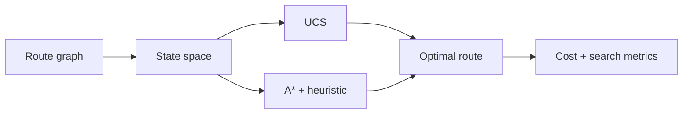

# Intelligent Route Planner

[](https://www.python.org/) [](#testing) [](LICENSE)

> Compare Uniform Cost Search and A* for optimal route planning on weighted graphs.

## Why this project exists

A delivery or navigation system needs to find a low-cost route while avoiding unnecessary exploration of the search space.

The implementation is intentionally small and reproducible so the underlying AI reasoning is easy to inspect, benchmark, and discuss.

## AI concepts demonstrated

Uniform Cost Search (UCS), A* Search, admissible heuristics, graph modeling, path reconstruction, complexity trade-offs

## Architecture



## Results

| Algorithm | Path cost | Nodes expanded |
|---|---:|---:|
| Uniform Cost Search | 13.48 | 7 |
| A* Search | 13.48 | 6 |

## Project structure

```text
intelligent-route-planner/
├── README.md
├── LICENSE
├── requirements.txt
├── examples/
│   └── demo.py
├── src/
│   └── implementation
└── tests/
    └── test_*.py
```

## Run locally

```bash
python -m venv .venv
# macOS/Linux
source .venv/bin/activate
# Windows PowerShell
# .venv\Scripts\Activate.ps1

pip install -r requirements.txt
python examples/demo.py
```

## Testing

```bash
PYTHONPATH=. pytest -q
```

## Ideas for extending the project

- Scale the environment or dataset and compare runtime and search behavior.
- Add richer visualizations or an interactive interface.
- Introduce additional baselines and ablation experiments.
- Add configuration files so experiments are reproducible from the command line.

## Portfolio note

This project is independently structured and documented as a portfolio implementation inspired by AI concepts studied in CS221. Do not publish course-provided starter code, solutions, tests, or restricted materials.

## GitHub metadata

**Repository name**

`intelligent-route-planner`

**Description**

`Compare Uniform Cost Search and A* for optimal route planning on weighted graphs.`

**Topics**

`artificial-intelligence` `a-star` `search-algorithms` `pathfinding` `graph-algorithms` `python` `cs221`
